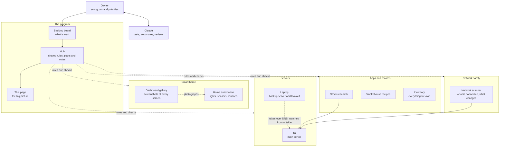

# midwest-labs

A home engineering program: we run a house full of technology the way a small company runs its systems. The
lights, the network, the servers, a few useful apps and the recipes all live in one organized, tested and
documented place, so they keep working and are easy to improve.

The owner decides what to build and what comes first. Claude does the testing, the automation and the tough
second look, so every change is checked against the real thing before it counts as done.

## What we are doing
> Next focus: Building a home grown platform operations ticketing and MCP-enabled service workflows for the homelab stack.
- **Making the home smarter and more reliable.** Lighting, sensors and dashboards that are used every day.
- **Keeping the network safe and always on.** Know what is connected, notice when something changes, and keep
  the internet's address book working even if the main server goes down.
- **Running our own servers.** One main server (the **1u**) hosts most things. A second machine (the **laptop**)
  stands by as a backup and a lookout.
- **Building small useful tools.** A stock research tracker, a smoking recipe site and a catalog of everything
  we own.
  Next for the catalog: upload a photo of an item to a page on our own network, and a local AI drafts the
  record for review. Photos stay at home, never sent to an outside service.
- **Being able to see it all.** Screenshots and dashboards that show how everything looks and whether it is healthy.

## How it fits together

The hub is the program's home base: it holds the rules every project follows and the notes on how things work. The
backlog board holds the work to be done. Each project below it does one job, and the hub keeps them consistent.

## Where the work is headed

| Focus | Why it matters |
|---|---|
| **Smart lighting** | The largest open backlog; lights are in daily use |
| **Monitoring dashboards** | Dashboards can only be judged by looking at them |
| **Backup server and DNS** | The internet's address book runs on one machine today; it needs a second |
| **Network scanner** | Know what is on the home network and when it changes |
| **Server health** | Keep the 1u healthy |
| **Program and process** | See all the work in one place and avoid rabbit holes |

## Not decided yet

- Whether the program adopts a heavier review process or stays light.
- How this page's summary refreshes automatically; until then it is updated by hand.
