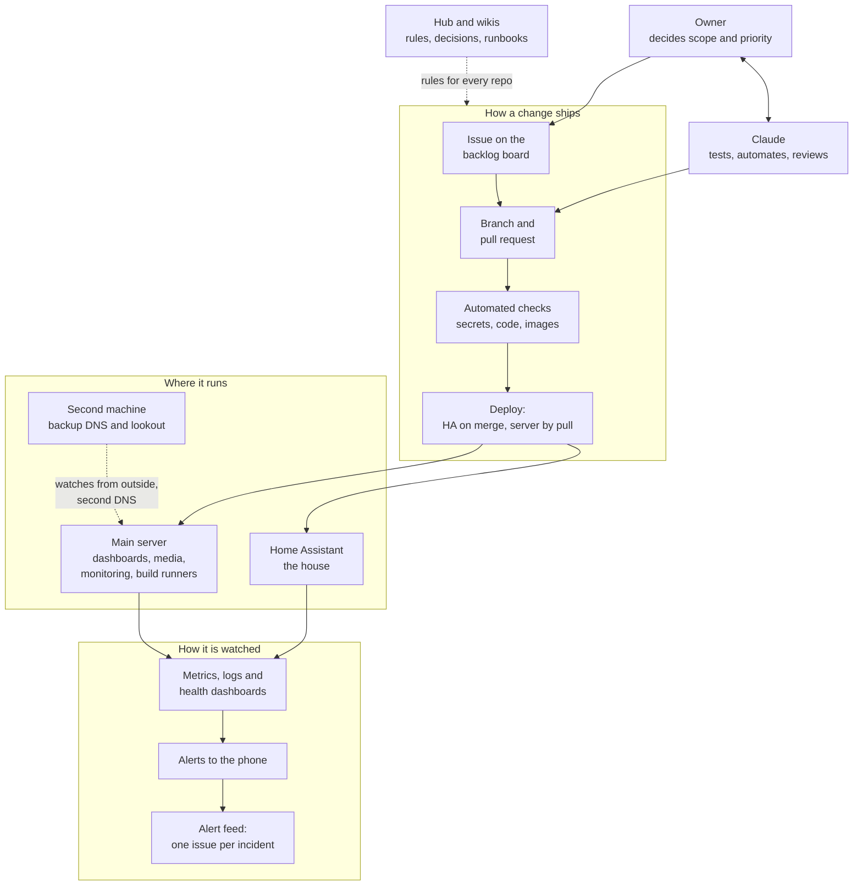

# midwest-labs

A home engineering program: a house full of technology run the way a small company runs its systems. The lights,
the network, the servers, a few useful apps and the recipes live in eleven organized, tested and documented
repositories, so they keep working and are easy to improve.

The owner leads all engineering work: what to build, how, and in what order. Claude does the testing, the automation
and the tough second look, so every change is checked against the real system before it counts as done.

## What has been built

| Layer | What it does |
|---|---|
| **Home automation** | A production Home Assistant setup: lighting, climate, sports, weather and daily-use dashboards. A gallery repo photographs every dashboard view twice a day so screens can be reviewed without opening them. |
| **Infrastructure** | One main server runs everything as code: a dashboard and data-collection stack, a media stack, and a monitoring stack (metrics, logs, alerts, image vulnerability scans). A second always-on machine keeps DNS up if the main one goes down and watches it from outside. |
| **Security** | A home network scanner finds what is connected and reports what changed. Every repo is secret-scanned before commit and in CI. |
| **Apps and data** | A stock research tracker, a smoking recipe site and an inventory of everything owned, one record per item. |
| **Program** | A hub repo holds the rules, decisions and plans every other repo follows. Work is tracked on one backlog board. |

## How it fits together

Every repo is a piece of one system. The hub sets the rules; the
monitoring stack watches the hosts and the apps; a firing alert reaches the phone and is also recorded as an issue the
owner can act on.

## How it is managed

- **One backlog.** Every piece of work is an issue on one board: epics hold features, features hold stories. No work
  happens without one, and it moves from backlog to sprint to done.
- **Every change is a pull request.** Work happens on a branch, never on `main`. Commits are signed.
- **Checks run before anything is trusted.** A fail-closed scan covers secrets (full history), code, dependencies
  and container images. "Fail-closed" means a check that cannot verify blocks instead of skipping.
- **Testing is not optional.** A change is validated against the real system, not just "it should work". The pull
  request says what was exercised and what was not.
- **Documentation moves with the change.** Rules, decisions and runbooks update in the same pull request, and the
  wikis rebuild on their own. Eleven written decision records explain why the big choices were made.
- **Claude has a defined role.** It tests, automates and challenges the work. It does not decide scope or
  architecture, and it works under the owner's direction.

## How it is maintained

- **Health at a glance.** Dashboards show the state of every stack. Alerts reach the owner's phone, and each incident
  also becomes a record, the input for a Claude triage routine now being built.
- **The server updates itself from `main`.** It pulls its configuration every few minutes and restarts what changed.
  Dependency updates arrive monthly in grouped pull requests.
- **Security hygiene on a schedule.** Container images are scanned weekly and a network scan flags new devices.
- **Resilience.** DNS has a second server, and databases and dashboards are backed up on a schedule.
- **Lessons are written down.** A case study records the decisions and mistakes made while building this, and feeds
  a planned training curriculum for non-engineers building with AI.

## Where the work is headed

| Focus | Why it matters |
|---|---|
| **Operations ticketing and MCP-enabled workflows** | Let alerts, tickets and runbooks work together, with Claude triaging what the alert feed collects |
| **Safe host automation** | Owner-triggered, named actions on the main server instead of copy-and-paste steps |
| **Runtime and runner upgrades** | Keep languages, base images and the build machines current |
| **Dashboards worth looking at** | Fewer, clearer screens in daily use |
| **Training curriculum** | Turn these working patterns into modules others can follow |

## Honest limits

- It is a solo program, so review is the owner's habit rather than a team gate.
- Some steps stay manual on purpose: live changes are run by the owner.
- Whether to adopt a heavier review process is undecided, deliberately.

This page is the big picture and is updated by hand. The repositories themselves are private.
